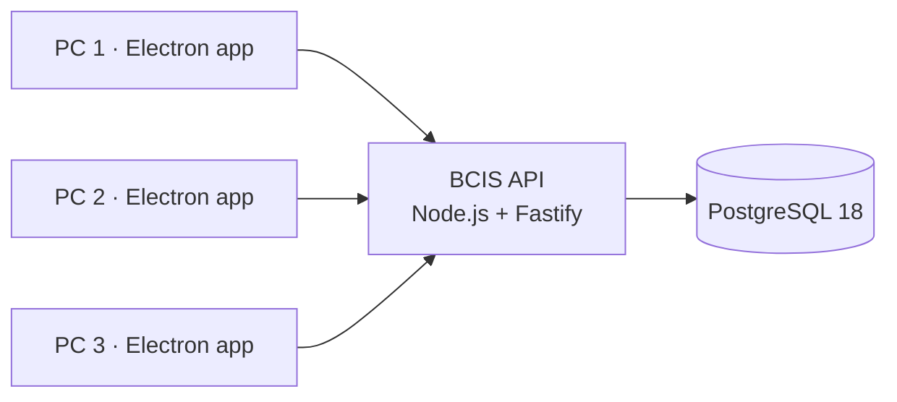

# BCIS Subscription Billing and Collection System

A desktop billing and collection system for **Bukidnon Cable and Internet Services**: three office
PCs share one server, handling subscribers, monthly billing, counter and GCash payments, field
collections, receivables, reports, audit and backups. Laboratory project, version 1.0.0.

The system's priority is financial correctness: amounts in integer centavos, balances from an
append-only ledger, posted records reversed but never deleted or overwritten, numbers that never
repeat, and every change audited.



| | |
|---|---|
| Server | Node.js 24, Fastify 5, Drizzle ORM, Zod 4, PostgreSQL 18, pino, argon2id |
| Desktop | Electron 44, React 19, Tailwind CSS 4 (Windows installer) |
| Shared | `@bcis/shared`: validation schemas, money and domain rules used by both sides |
| Quality | TypeScript strict, Vitest against a real database (770 tests), oxlint |

## Features

- **Subscribers and services**: registration, addresses and contacts, search everywhere (Ctrl+K),
  nine-tab profile, internet / cable / combo plans, service history.
- **Billing**: monthly draft-and-finalize billing, installation and reconnection fees, voids,
  credit and debit adjustments, subscriber ledger, Statement of Account.
- **Payments**: cash, bank, cheque; oldest-first allocation or chosen invoices; advance payments
  kept as credit; printable receipts; reversals with reason.
- **GCash**: submissions with proof images, verify or reject, duplicate references blocked.
- **Collections**: collector batches with route sheets, field collections, remittances,
  reconciliation that records shortages and overages.
- **Receivables**: outstanding and overdue lists, AR aging, suspension candidates, suspension and
  reconnection workflow.
- **Reports and dashboard**: KPIs and charts; collections, billing vs collection, revenue, aging,
  collector performance, master list, exceptions, user activity; PDF and Excel export.
- **Administration**: users and roles, forced password change, lockout, settings, audit log,
  verified backups, test restore, guarded restore, integrity check.

## Documentation and deliverables

| Deliverable | Where |
|---|---|
| D1 Source repository | This repository: source, Git history, `.gitignore`, `.env.example`, migrations (`database/migrations`), seeds (`database/seeds`) |
| D2 Working release | Windows installer on the [GitHub Releases page](https://github.com/Ennius5/bcis-subscription-billing-system/releases); server setup in [docs/deployment-guide.md](docs/deployment-guide.md) |
| D3 Technical documentation | [docs/technical-documentation.pdf](docs/technical-documentation.pdf) (source: [.md](docs/technical-documentation.md)), ERD [docs/erd.pdf](docs/erd.pdf), [security review](docs/security-review.md) |
| D4 User manual | [docs/user-manual.pdf](docs/user-manual.pdf) (source: [.md](docs/user-manual.md)) |
| D5 Testing package | [tests/acceptance-test-report.pdf](tests/acceptance-test-report.pdf), [docs/bug-log.md](docs/bug-log.md), [docs/qa-checklist.md](docs/qa-checklist.md) |
| D6 Reports | [reports-samples/](reports-samples/) (every report as PDF and XLSX) |
| D7 UI evidence | [tests/screenshots/](tests/screenshots/) |
| D8 Presentation / defense | [docs/defense-notes.md](docs/defense-notes.md) (live demo script, defense questions) and the presentation slides |

### Spec submission layout (section 9.1) and this repository

The repository is a pnpm monorepo, so the source is split by application instead of one `source/`
folder:

| Spec folder | Here |
|---|---|
| `source/` | `apps/api` (server), `apps/desktop` (Electron app), `packages/shared` (shared rules) |
| `database/migrations/`, `database/seeds/` | Same paths |
| `docs/technical-documentation.pdf`, `user-manual.pdf`, `erd.pdf`, `deployment-guide.md` | Same paths |
| `tests/acceptance-test-report.pdf`, `tests/screenshots/` | Same paths |
| `reports-samples/` | Same path |
| `release/` | The installer is attached to the GitHub release (107 MB, too large for Git); built locally into `apps/desktop/release/` |
| `README.md` | This file |

## Getting started (development)

Requirements: Windows 10/11, Node.js 24, pnpm 11, PostgreSQL 18.

1. Create the role and databases (in psql as `postgres`), as in section 3.2 of the
   [deployment guide](docs/deployment-guide.md): `bcis`, `bcis_test`, and `bcis_verify` /
   `bcis_test_verify` for test restores, all owned by `bcis_app`.
2. Copy `.env.example` to `apps/api/.env` and fill in the passwords.
3. Install and prepare:

   ```powershell
   pnpm install
   pnpm --filter ./apps/api db:migrate
   pnpm --filter ./apps/api db:seed-all     # roles, owner, demo users, demo dataset
   ```

   The demo dataset needs a fresh database; see [database/seeds/README.md](database/seeds/README.md).
4. Run the API and the app (two terminals):

   ```powershell
   pnpm --filter ./apps/api dev
   pnpm --filter @bcis/desktop dev
   ```

   Sign in with the owner from `.env` or a demo user (`demo_admin`, `demo_cashier`,
   `demo_supervisor`, `demo_auditor`, `demo_technician`, `demo_viewer`) with `SEED_DEMO_PASSWORD`.

## Production

```powershell
pnpm --filter ./apps/api build            # API bundle in apps/api/dist
pnpm --filter @bcis/desktop dist          # installer in apps/desktop/release
```

Server installation (scheduled API task, daily backup, firewall rule), client installation, backup
and restore: [docs/deployment-guide.md](docs/deployment-guide.md).

## Tests and evidence

| Command | What it does |
|---|---|
| `pnpm --filter @bcis/api test`, `pnpm --filter @bcis/shared test` | All automated tests |
| `pnpm --filter @bcis/api typecheck` (also `@bcis/shared`, `@bcis/desktop`), `pnpm lint` | Types and lint |
| `pnpm --filter ./apps/api acceptance` | AT-01..AT-12, reconciliation checks and all tests; writes `tests/acceptance-test-report.md/.pdf` |
| `pnpm --filter ./apps/api concurrency` | Three-session posting test against a running server (AT-09 on real PCs) |
| `pnpm docs:build` | Regenerates the ERD, data dictionary and API reference, and renders the documentation PDFs |
| `pnpm --filter ./apps/api report-samples` | Exports every report into `reports-samples/` |
| `pnpm screenshots` | Drives the desktop app and saves `tests/screenshots/` |

## Repository layout

```
apps/
  api/          Fastify API: src/<module>/ (service, routes, tests), scripts/
  desktop/      Electron app: src/main (IPC, token), src/preload, src/renderer (React)
packages/
  shared/       @bcis/shared: Zod schemas, money, allocation, aging, permissions
database/       migrations/ and seeds/
deploy/         PowerShell scripts for the server PC
docs/           documentation (and docs/generated: ERD, data dictionary, API reference)
tests/          acceptance report, screenshots, fixtures
reports-samples/
scripts/        Markdown-to-PDF, docs build, screenshots
```

## AI-assisted development

Built with Claude Code as a coding assistant, as allowed by the laboratory (spec section 12).
Project rules for the assistant are in [CLAUDE.md](CLAUDE.md). Work was done in small steps, each
implemented with its migration, validation and tests, then typechecked, tested, linted and reviewed
for financial and security impact before being committed; the Git history shows that progression.
All data used is synthetic.
