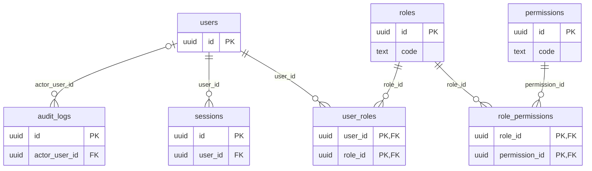
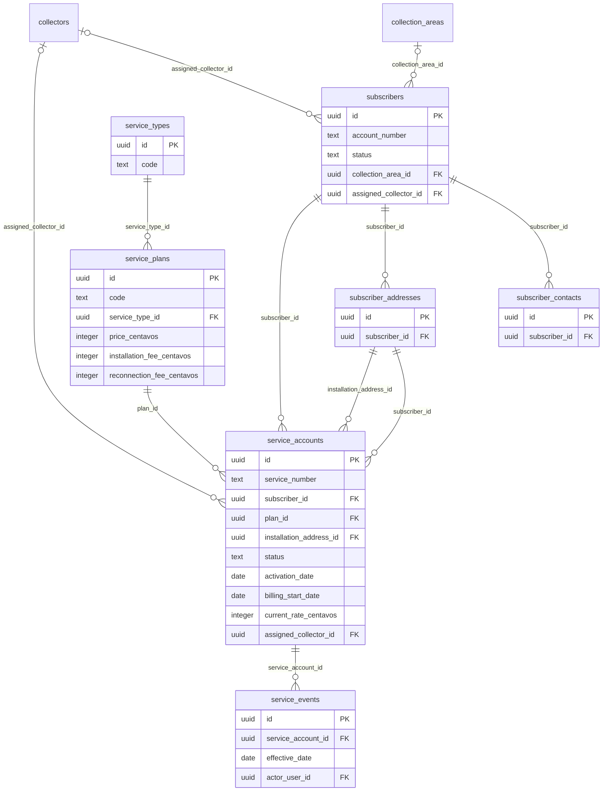
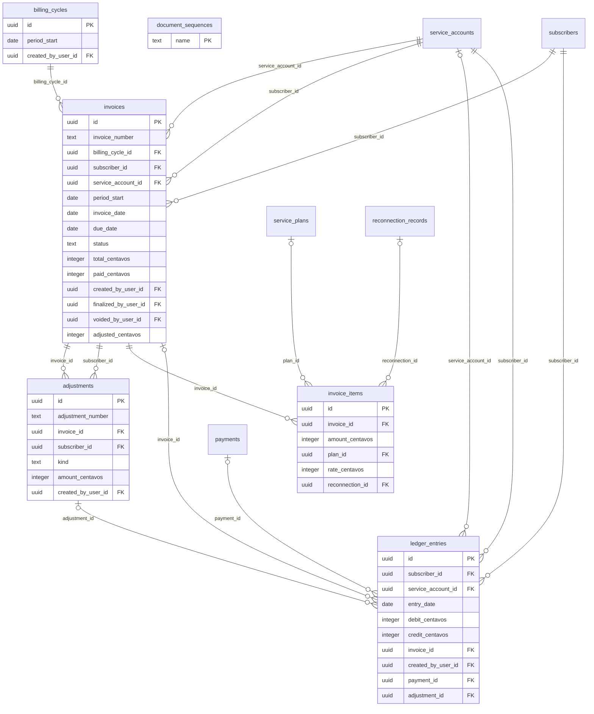
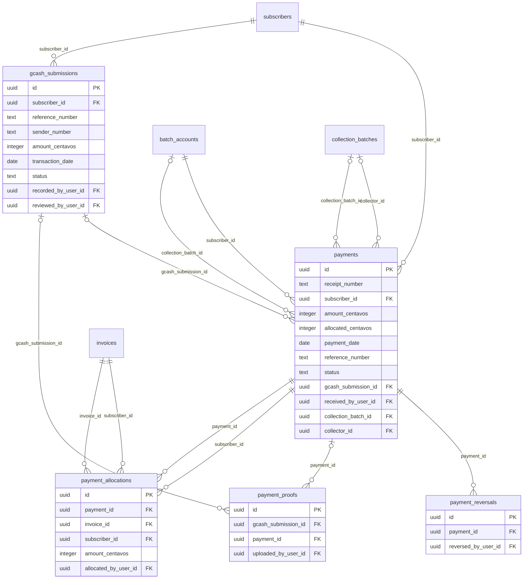
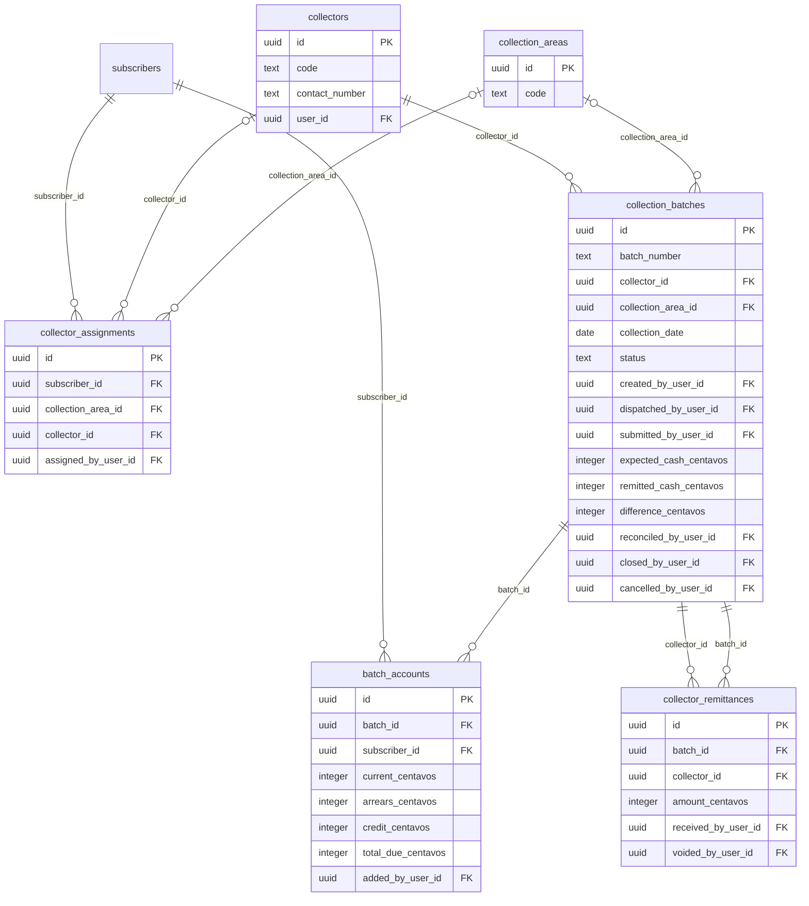
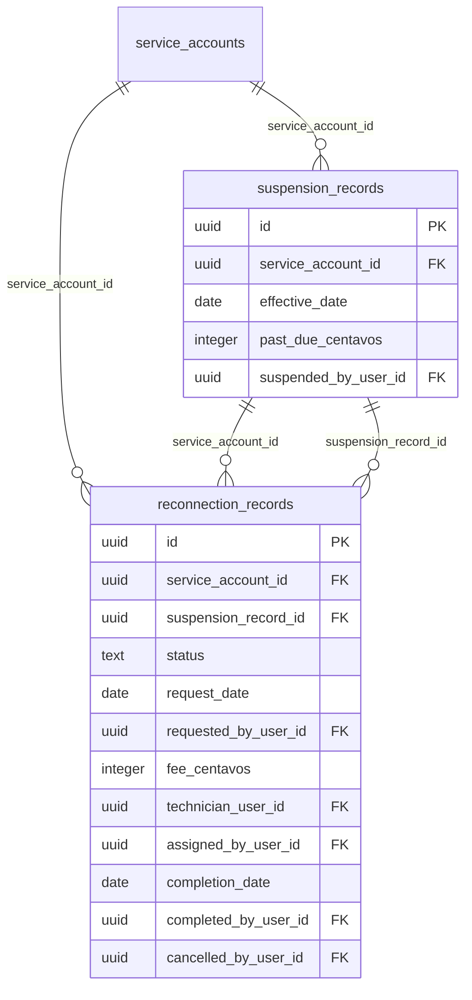
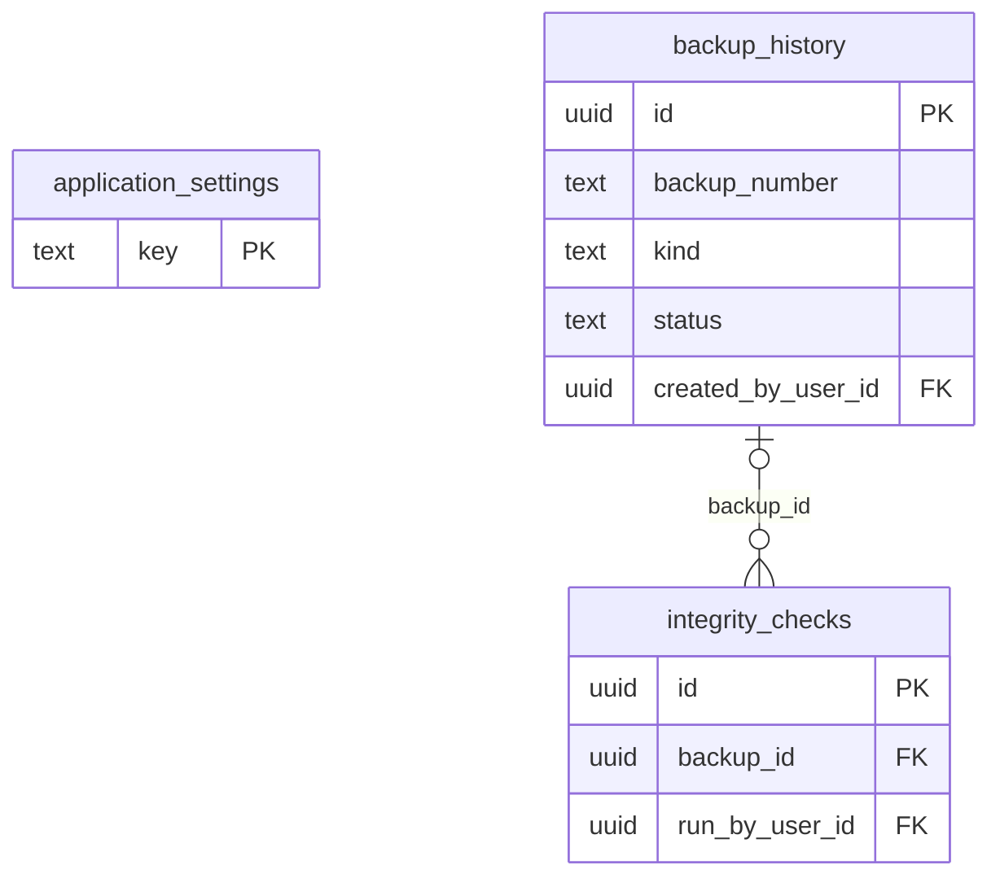

# Entity-Relationship Diagram

Generated from the migrated database. One diagram per module; tables from other modules appear without columns where they are referenced. Only keys, money, document numbers, statuses and key dates are drawn; every column is in the data dictionary. Most tables also record who created or changed a row (a foreign key to `users`); those links are drawn only in the first diagram, to keep the others readable.

Notation: `||--o{` one to many; `|o--o{` the parent is optional (nullable foreign key).

## Access and audit

Who can sign in, what each role may do, live sessions, and the append-only audit trail.

## Subscribers and services

Customers, their addresses and contacts, the plans offered, and each service account with its history.

## Billing and ledger

Monthly billing runs, invoices and their lines, adjustments, and the subscriber ledger that every balance comes from.

## Payments and GCash

Money received, how it was applied to invoices, reversals, and GCash submissions with their proof images.

## Collections

Collection areas, collectors, their batches (route sheets), field collections and cash remittances.

## Service control

Suspensions for non-payment and the reconnection workflow, including the reconnection fee.

## Settings, backups and integrity

Business settings, the backup history and the results of integrity checks.

