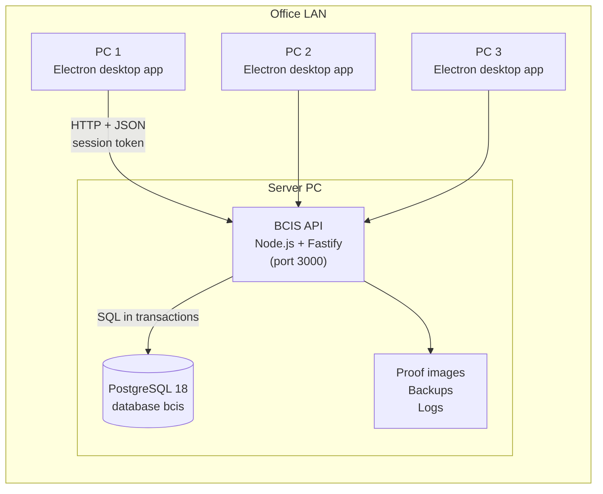
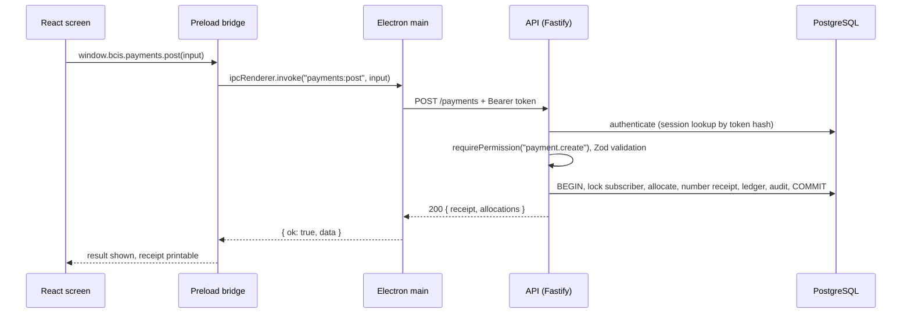
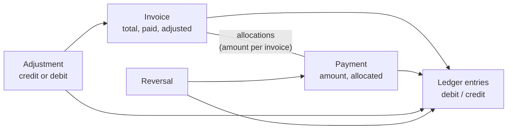
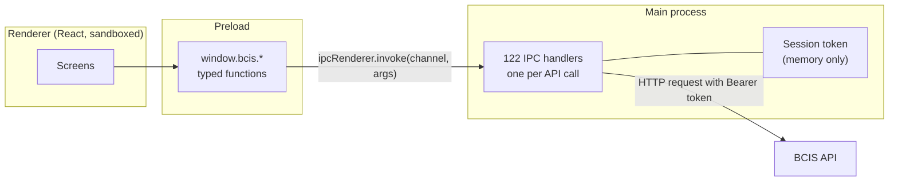

# BCIS Subscription Billing and Collection System: Technical Documentation

Deliverable D3. Requirements, architecture, modules, data model, API and IPC design, security
model, deployment and backup/restore of the billing and collection system built for Bukidnon
Cable and Internet Services (BCIS).

Related documents:

| Document | Contents |
|---|---|
| `docs/erd.pdf` | Entity-relationship diagrams, one per module (also Appendix A) |
| Appendix B (`docs/generated/data-dictionary.md`) | Every table, column, constraint, index and trigger, generated from the database |
| Appendix C (`docs/generated/api-reference.md`) | Every API route with the permission it requires, and the role/permission matrix |
| `docs/deployment-guide.md` | Server and client installation, backups, restore, troubleshooting |
| `docs/security-review.md` | Security requirements and the evidence for each |
| `tests/acceptance-test-report.pdf` | Results of acceptance tests AT-01 to AT-12 and all automated tests |
| `docs/bug-log.md`, `docs/qa-checklist.md` | Defects found and fixed; final submission checklist |

The appendices are generated from the running system (`pnpm --filter ./apps/api docs:reference`),
so they always match the code.

---

## 1. Requirements

### 1.1 Business context

BCIS sells internet, cable TV and combined (combo) subscriptions in Bukidnon. Three office PCs
handle subscribers, monthly billing, counter payments and GCash payments that customers report by
message; field collectors go out on routes, collect cash, and remit it to the office. The business
needs to know at any moment what each subscriber owes, which accounts are overdue, whether each
collector's cash is complete, and who changed what.

The system replaces paper ledgers and spreadsheets. Its core promise is financial correctness:
balances computed from posted records, history that is never overwritten, and numbers (invoices,
receipts) that never repeat.

### 1.2 Users and roles

| Role | Typical user | Main work |
|---|---|---|
| Owner / Super Admin | Business owner | Everything, including users, settings, backup and restore |
| Administrator | Office manager | Subscribers, plans, services, billing, payments, collections, reports |
| Cashier | Counter staff | Receive payments, issue receipts, record and verify GCash |
| Collection Supervisor | Collections lead | Areas, collectors, batches, remittances, reconciliation |
| Accounting / Auditor | Bookkeeper | Read everything financial, reports, audit trail |
| Technician | Field technician | Service status, suspensions and reconnections |
| Read-only Viewer | Management | Dashboard, reports and receivables |

What each role may do is a set of permissions checked by the server (Appendix C has the matrix).
A user may hold more than one role.

### 1.3 Functional requirements by module

| Module | What the system does |
|---|---|
| Subscribers | Register subscribers with addresses and contacts; search by account number, name, phone, address, receipt, invoice or GCash reference; status changes (active, inactive, terminated, archived) with reasons; a nine-tab profile (overview, services, billing, payments, ledger, collection, history, documents, audit). |
| Plans and services | Plans per service type (internet, cable, combo) with price, speed or channels and fees; service accounts per subscriber with installation, activation, plan and rate changes, all kept as history. |
| Billing | Monthly billing in two steps (generate drafts, then finalize with numbers); installation and reconnection fees on the right invoice; voids with reason; credit and debit adjustments; the subscriber ledger and Statement of Account. |
| Payments | Counter payments (cash, bank transfer, cheque, other) with receipts; oldest-first allocation or manual allocation; advance payments kept as credit; reversals with reason. |
| GCash | Record customer-reported GCash payments with proof images; verify (posts the payment) or reject; duplicate references blocked. |
| Collections | Areas and collectors; collection batches built from what subscribers owe (route sheet); field collections; remittances; reconciliation of cash collected against cash remitted; shortages and overages recorded with a reason. |
| Receivables and service control | Outstanding and overdue lists; AR aging (current, 1-30, 31-60, 61-90, 90+ days); suspension candidates by configurable grace period and threshold; suspension with approval; reconnection workflow with fee or waiver. |
| Reports and dashboard | Dashboard KPIs and charts; collections, billing vs collection, revenue, AR aging, collector performance, subscriber master list, exceptions (adjustments and reversals), user activity, Statement of Account; PDF and XLSX export. |
| Administration | Users and roles, forced password change, account unlock; settings; audit log; backups, verification, test restore and restore; integrity check. |

### 1.4 Non-functional requirements

| Requirement | How it is met |
|---|---|
| Three PCs working at the same time | One API server; every change in a database transaction with row locks; numbering under locks (section 6). Proven by AT-09. |
| Financial correctness | Integer centavos; balances from the ledger; append-only history enforced by database triggers; reconciliation checks across reports (QA checklist item 12). |
| Security | Server-side authentication and permission checks on every route; argon2id passwords; hardened Electron client (section 9). |
| Auditability | Every change writes an audit row in the same transaction: who, what, when, why, old and new values. |
| Recoverability | Verified daily backups, test restores and a guarded restore (section 11). |
| Usability | Desktop UI with dense tables, keyboard search (Ctrl+K), right-aligned money in tabular numerals, status shown with text and colour, printable receipts and route sheets. |

---

## 2. Architecture

### 2.1 Overview

The desktop app never talks to the database. Every PC sends requests to the one API, which checks
the session and permissions, validates the input, runs the business rule in a database
transaction, writes the audit row and answers. One of the three office PCs can be the server.

### 2.2 Why a client-server design with PostgreSQL

A shared database file (for example SQLite on a network folder) cannot safely take writes from
three PCs at once: file locking over the network is unreliable, there is no server to enforce
permissions, and each PC would need the business rules and full write access to the file. With
PostgreSQL behind one API:

- transactions and row locks make concurrent posting safe (no duplicate receipt numbers, no lost
  updates);
- constraints, unique indexes and triggers enforce the most important rules in the database
  itself, whatever the client does;
- permissions are checked on the server, so a modified client cannot bypass them;
- backups are consistent snapshots (`pg_dump`) taken while people keep working.

### 2.3 Technology stack

| Layer | Technology |
|---|---|
| Language | TypeScript (strict), one pnpm monorepo |
| Server | Node.js 24, Fastify 5, Drizzle ORM, Zod 4, pino logging, argon2id (`@node-rs/argon2`) |
| Database | PostgreSQL 18 (migrations with drizzle-kit, plus hand-written triggers) |
| Desktop | Electron 44, React 19, Tailwind CSS 4, electron-vite, electron-builder (Windows installer) |
| Reports | pdfmake (PDF), ExcelJS (XLSX) |
| Tests | Vitest 5 against a real PostgreSQL test database |
| Quality | oxlint with type-aware rules; TypeScript typecheck on every package |

### 2.4 Repository layout

| Path | Contents |
|---|---|
| `apps/api` | The API server: `src/<module>/` (service, routes, tests per module), `scripts/` (build, reports, docs) |
| `apps/desktop` | The Electron app: `src/main` (window, IPC, session token), `src/preload` (the bridge and DTO types), `src/renderer` (React screens) |
| `packages/shared` | `@bcis/shared`: Zod schemas, money helpers, domain rules (allocation, aging, billing periods), permissions and navigation, used by both API and desktop |
| `database/migrations` | 27 SQL migrations and the drizzle journal |
| `database/seeds` | How to seed (the seed scripts are in `apps/api/src/db`) |
| `deploy` | PowerShell scripts that install the server tasks and firewall rule |
| `docs`, `tests` | Documentation, acceptance report, screenshots |

### 2.5 Life of a request

If anything fails before `COMMIT`, PostgreSQL rolls the whole transaction back: there is no
half-posted payment, and the receipt number taken inside the transaction is returned to the
counter. The client shows the error with a reference that matches the server log.

---

## 3. Module description

### 3.1 API modules (`apps/api/src`)

| Module | Responsibility | Main tables |
|---|---|---|
| `auth` | Sign-in, sessions, lockout, `authenticate` and permission guards | users, sessions |
| `admin` | User management, roles, password reset and change | users, user_roles |
| `audit` | Writing audit rows (`writeAudit`) and the audit log queries | audit_logs |
| `subscribers` | Subscribers, addresses, contacts, status, search, profile data | subscribers, subscriber_addresses, subscriber_contacts |
| `plans` | Service plans | service_plans, service_types |
| `service-accounts` | Service accounts, status, plan, rate and collector changes, history | service_accounts, service_events |
| `billing` | Billing runs, invoices, voids, adjustments, ledger, Statement of Account data | billing_cycles, invoices, invoice_items, adjustments, ledger_entries |
| `payments` | Payments, allocation, credit, reversals, GCash submissions, proof storage | payments, payment_allocations, payment_reversals, gcash_submissions, payment_proofs |
| `collection` | Areas, collectors, batches, field collections, remittances, reconciliation, collector report | collection_areas, collectors, collector_assignments, collection_batches, batch_accounts, collector_remittances |
| `receivables` | Outstanding/overdue lists, aging, suspension candidates, suspensions, reconnections, settings | suspension_records, reconnection_records, application_settings |
| `reports` | Report queries, dashboard, PDF and XLSX rendering, audited exports | (reads all) |
| `backup` | Backups, manifest, verification, integrity check, test restore, restore | backup_history, integrity_checks |
| `http` | Error handling, request ids, logging, maintenance gate | |
| `db` | Connection, schema, migrations, document numbers, seeds | document_sequences |

Each module follows the same shape: a **service** (business rules, transactions, audit), **routes**
(HTTP, authentication, permission, validation, error mapping) and **tests**. Services throw typed
errors (`PaymentError`, `BillingError`, ...) with a code and HTTP status; routes map them.

### 3.2 Desktop app (`apps/desktop`)

- **Main process** (`src/main/index.ts`): creates the window, holds the session token, and has one
  IPC handler per API call (122 handlers). It also saves exported files through the Save dialog
  and stores the server address in the user's settings folder.
- **Preload** (`src/preload/index.ts`): exposes `window.bcis` to the page through Electron's
  context bridge, with typed functions and the data types (DTOs) of every response.
- **Renderer** (`src/renderer/src`): React screens grouped like the menu: subscribers, billing,
  payments, collection, receivables, reports, dashboard, admin, plus shared UI parts (data table,
  money and date fields, badges, pager). The theme lives in one stylesheet.

### 3.3 Shared package (`packages/shared`)

Code both sides must agree on: every Zod input schema (the API validates with it, the forms use it
for instant feedback), money parsing and formatting in centavos, the allocation algorithm, billing
period arithmetic, aging buckets, cash variance, permission codes, role definitions and the
navigation tree. 209 unit tests cover it.

---

## 4. Data design

### 4.1 Principles

1. **Money is integer centavos** (`*_centavos` columns, integer types). Pesos are converted only at
   the form edge and for display. No floating point touches an authoritative amount.
2. **Posted financial records are never deleted or overwritten.** Payments are reversed, invoices
   voided, adjustments countered by an opposite adjustment. Allocations, reversals, ledger entries,
   proofs, service events, integrity checks and audit rows are append-only; database triggers
   reject `UPDATE` and `DELETE` on them.
3. **Master data is deactivated, not deleted**: users, plans, areas, collectors, addresses and
   contacts have an active flag; subscribers have a status.
4. **The ledger is the source of the balance.** Every invoice, payment, reversal, void and
   adjustment writes a ledger entry; a subscriber's balance is the sum of debits minus credits.
5. **Rules are enforced twice**: in the service, and in the database where it can be expressed
   (unique indexes, check constraints, triggers), so a bug or a direct SQL mistake cannot break
   them silently.
6. **Every schema change is a migration** (`database/migrations`), applied in order by
   `db:migrate`.

### 4.2 The financial model

- An **invoice** stores its total, the paid amount and the net adjustments. Its balance is
  `total + adjusted - paid`; its status is unpaid, partially paid, paid or void (and shown as
  overdue when open past its due date).
- A **payment** stores its amount and how much of it is allocated. **Allocations** say how much of
  the payment went to which invoice. A **partial payment** is simply an allocation smaller than the
  invoice balance: the invoice becomes partially paid and keeps the rest as its balance (AT-02).
- Money not allocated is the subscriber's **credit**: `amount - allocated` on posted payments. It
  is applied oldest-first when new invoices are finalized (AT-03).
- The **ledger** records every movement, so the balance (`sum(debit) - sum(credit)`) always equals
  open invoice balances minus credit. The integrity check and the reconciliation tests verify this
  identity across the whole database.

### 4.3 Entity-relationship diagram and data dictionary

The database has 36 tables in seven modules (access and audit; subscribers and services; billing
and ledger; payments and GCash; collections; service control; settings, backups and integrity).
The diagrams are in Appendix A and `docs/erd.pdf`; every column, constraint, index and trigger is
in Appendix B.

### 4.4 Document numbers

Invoice (`INV-`), receipt (`RCPT-`), adjustment (`ADJ-`), collection batch (`CB-`) and backup
(`BK-`) numbers come from `document_sequences`. A number is taken by updating the counter row inside
the posting transaction, which locks the row until commit. Two PCs posting at once therefore wait
for each other briefly and get consecutive numbers; a failed posting rolls the counter back, so
numbers neither repeat nor skip. Voided invoices and reversed receipts keep their numbers forever.

---

## 5. Business rules

### 5.1 Billing

- **Generate** creates draft invoices for every active service account whose billing has started
  and that has no live invoice for the month: the subscription at the account's current rate, the
  installation fee in the month billing started, and any completed reconnection fee not yet billed.
  Drafts have no number and are not on the ledger. Running it again only adds drafts for accounts
  that became billable since (AT-11). Billing can run up to one month ahead.
- **Finalize** numbers the drafts, posts a ledger debit for each on its invoice date, and applies
  any available credit. Drafts of accounts suspended or terminated since generating are skipped.
- One live invoice per service account per month is also enforced by the unique index
  `invoices_one_per_period_idx`.
- **Void** (with a reason) is allowed only when no payment is applied; it posts a ledger credit and
  frees the month to be billed again.
- **Adjustments** are credits (discount, outage rebate, billing error, goodwill) or debits
  (penalty, reconnection fee, billing error) with a reason. A credit cannot exceed what is owed.

### 5.2 Payments and allocation

- A payment is applied to open invoices **oldest first** (by due date) unless a user with
  `payment.allocate` chooses the invoices by hand. Any amount left over becomes credit.
- A payment date may be in the past (late entry) but never in the future.
- **Reversal** (`payment.reverse`, reason required): the payment keeps its receipt number and is
  marked reversed; a reversal record and a ledger debit are added; the amounts it paid are taken
  off the invoices, which reopen, while its allocation rows stay as history. Nothing is deleted
  (AT-06).

### 5.3 GCash

Customers pay by GCash and send a screenshot. Staff record a submission (reference, sender, amount,
date) and attach the proof image. A reviewer with `gcash.verify` then verifies it, which posts a
GCash payment dated on the transaction date, or rejects it with a reason. Proof is required before
verifying. A GCash reference can be used once: references are normalized (spaces removed,
upper case) and protected by a unique index, so a second submission with the same
reference is refused, naming the receipt that already used it (AT-05).

### 5.4 Collections

A batch moves through **open → in progress (dispatched) → submitted → remitted → reconciled →
closed**, or is cancelled with a reason. It is built from the collector's subscribers who owe
something, with a snapshot of what each owed (the route sheet). Field collections are payments
posted through the batch, with receipts. Remittances record the cash handed over. Reconciliation
compares cash collected with cash remitted: the difference is computed by the server, a shortage or
overage needs a reason, and the reconciler must confirm the figure shown. Closing requires
confirming the same difference again, so a short batch can never be closed as balanced (AT-07,
AT-08). Reconciling and closing are separate permissions.

### 5.5 Receivables and service control

- **Aging** puts each open invoice in a bucket by days past its due date: current, 1-30, 31-60,
  61-90, 90+. Unapplied credit is shown separately, so the aging total equals open invoice
  balances and the net equals the ledgers.
- **Suspension candidates** are active services with at least *threshold* invoices more than
  *grace period* days past due (both in Settings). The list is advice; suspending is a separate
  action with a reason and approver.
- **Reconnection**: request (with the fee, or a waiver with reason), assign a technician, complete.
  The fee goes on the next invoice.

---

## 6. Concurrency and consistency

- **One transaction per operation.** Each service function does its reads, writes, ledger entries,
  numbering and audit row in one transaction (`db.transaction`), passing the same handle to
  `writeAudit`.
- **Row locks** (`SELECT ... FOR UPDATE`) on the rows being changed. Money operations lock the
  subscriber first, then their invoices, always in that order, so two PCs working on the same
  subscriber queue instead of deadlocking.
- **Counter rows** for document numbers are locked until commit (section 4.4).
- **Advisory locks** guard the few rules that span many rows: "at least one owner remains", and "a
  subscriber is on at most one live collection batch".
- **Unique indexes** are the last line: one invoice per account per month, one GCash reference,
  unique document numbers.
- **What if the API crashes halfway through posting a payment?** The transaction never commits, so
  PostgreSQL discards all of it: no payment, no allocation, no ledger entry, no audit row, no
  receipt number used. The cashier sees an error and posts again. An unexpected error answers
  "check before retrying" with a reference, because a commit may have succeeded just before a
  network failure; the payment list shows the truth.

AT-09 posts payments from three sessions in parallel and checks for gaps, repeats and balance
errors; `concurrency/at09.test.ts` does the same with billing, field collections and adjustments.

---

## 7. API design

- **Style**: JSON over HTTP, resource paths (`/subscribers/:id/ledger`), `GET` to read, `POST`
  for actions (each business action has its own endpoint and audit action, for example
  `/payments/:id/reverse`, `/subscribers/:id/status`), `PATCH` for edits of master data.
- **Authentication**: `POST /auth/login` returns a session token; every other call sends
  `Authorization: Bearer <token>`.
- **Authorization**: `authenticate` then `requirePermission(...)` on every route. The permission
  required by each route is listed in Appendix C, which is generated from the route table itself.
  A test calls every route without a token (401) and as a user with no roles (403).
- **Validation**: every body, query and path parameter is parsed with a Zod schema from
  `@bcis/shared`. Update schemas are strict (unknown fields refused) and need at least one change
  besides the reason. Failures answer `400 { error: "VALIDATION", issues: [{ path, message }] }`,
  which the forms map to fields.
- **Errors**: `{ error: CODE, message }` with the matching status: 401, 403, 404, 409 (state
  conflict, duplicate), 422 (business rule), 423 (account locked), 503 (database unavailable or
  maintenance). Unexpected errors answer 500 with a reference id that appears in the server log.
- **Lists** are paged (`page`, `pageSize`) and return `total`.
- **Exports**: `.../export?format=pdf|xlsx` returns the file; every export is audited.

---

## 8. IPC design (desktop)

- `contextIsolation` is on and `nodeIntegration` off: page code cannot reach Node.js or Electron.
- The renderer sees only `window.bcis`, a fixed set of functions (`payments.post`,
  `subscribers.get`, ...). There is no generic "call any URL" channel.
- The **session token stays in the main process** and is never given to the page.
- Each handler encodes ids with `encodeURIComponent`, calls the API and returns
  `{ ok: true, data }` or `{ ok: false, code, message, issues, reference }`. `UNAUTHENTICATED`
  sends the user back to sign-in.
- Exports are saved through the system Save dialog by the main process.
- The server address is set on the sign-in page; the main process checks that the address answers
  as a BCIS server before saving it.

---

## 9. Security model

Summary; the requirement-by-requirement evidence is in `docs/security-review.md`.

| Area | Design |
|---|---|
| Passwords | argon2id hashes; at least 10 characters; new users must choose their own password at first sign-in; never logged (audit and log redaction of password and token fields). |
| Sign-in | 5 wrong passwords lock the account for 15 minutes (also on "Change my password"); an owner can unlock. |
| Sessions | Random 32-byte token; only its SHA-256 hash is stored. Ends after 30 minutes idle or 12 hours. Sign-out, password change, password reset and restore end sessions. |
| Authorization | Permissions are read from the database on every request and checked on the server; hiding a menu item is only a convenience. Every route is tested for 401/403. |
| Input | Zod validation of every input; parameterized SQL only. |
| Desktop | Context isolation, no Node in the page, a strict Content Security Policy, all permission prompts (camera, location, ...) refused, no developer menu in the installed app. |
| Files | Proof images checked by content (PNG, JPEG, WebP), up to 5 MB, stored under a generated name in one folder, with a SHA-256 checked by the integrity check. |
| Audit | Append-only audit rows for every change, with actor, reason, old and new values. |
| Transport and data at rest | Plain HTTP inside the office LAN (accepted risk, documented); secrets only in the server's `.env`; backups stored on the server. |

---

## 10. Reports, exports and logging

- Reports are computed from the same tables as the screens: collections by period and method,
  billing vs collection, revenue, AR aging, collector performance, subscriber master list,
  exceptions (adjustments and reversals), user activity, and the Statement of Account. The
  reconciliation test checks their totals against the underlying records and the exported XLSX
  against the report.
- Each report renders to PDF (pdfmake) and XLSX (ExcelJS) from one document description, so both
  formats show the same figures. Exports are audited (`report.export`).
- The server logs with pino to the console and to daily files (`logs/api.YYYY-MM-DD.N.log`, 30
  days kept). Every response carries an `x-request-id`; an unexpected error shows that id to the
  user as a reference.

---

## 11. Deployment and backup/restore

Full steps are in `docs/deployment-guide.md`. In short:

- **Server PC**: PostgreSQL 18, Node 24 and the built API (`pnpm --filter ./apps/api build`).
  `deploy/install-server.ps1` registers two scheduled tasks (the API at start-up, kept running by a
  watchdog script; a daily backup) and a firewall rule for the local subnet.
- **Client PCs**: the Windows installer (`BCIS-Billing-Setup-x.y.z.exe`); the server address is
  entered once on the sign-in page.
- **Backups**: `pg_dump` (custom format) from one consistent snapshot while people keep working,
  plus a copy of the proof images and a `manifest.json` with row counts and a SHA-256 for every
  file. Each backup is verified (checksums, and `pg_restore --list` must read it). A daily backup
  runs automatically; the app warns when the last good backup is older than 24 hours.
- **Test restore** restores a backup into a scratch database (`bcis_verify`) and runs the integrity
  check on it, without touching live data.
- **Restore** (owner only, `backup.restore`): the user types the backup number and a reason; the
  API blocks all other requests (maintenance mode), takes a safety backup, restores with
  `pg_restore --clean --single-transaction` (all or nothing), keeps the backup history, signs
  everyone out, copies the proof images back and runs the integrity check (AT-12).
- **Integrity check** (also on demand): paid amounts equal allocations, allocations never exceed
  payments, ledger balances reconcile, counters are ahead of every issued number, proof files match
  their checksums, the migration count matches, and (after a restore) row counts match the backup.

---

## 12. Testing

| Level | What | Where |
|---|---|---|
| Unit | Money, allocation, aging, billing periods, validation schemas | `packages/shared/src/*.test.ts` (209 tests) |
| Integration | Every service and route against PostgreSQL, including rollback on failure and audit rows | `apps/api/src/**/*.test.ts` |
| Acceptance | AT-01 to AT-12 with the spec's data, over HTTP | `apps/api/src/acceptance/acceptance.test.ts` |
| Reconciliation | Every money report against the records on the full demo dataset | `apps/api/src/acceptance/reconciliation.test.ts` |
| Security | Every route refuses missing sessions and missing permissions | `apps/api/src/security/route-guards.test.ts` |
| Concurrency | Parallel billing, payments, collections; three-PC script | `apps/api/src/concurrency/` |
| Desktop | Manual walkthrough of every workflow; screenshots | `tests/screenshots/` |

Results: `tests/acceptance-test-report.pdf`. Defects: `docs/bug-log.md`.

---

## 13. Design decisions

| Decision | Alternatives | Why |
|---|---|---|
| One API server and PostgreSQL | Shared SQLite or Access file | Safe concurrent writes, server-side permissions, constraints and consistent backups (section 2.2). |
| Integer centavos | Decimal or floating point | Exact arithmetic everywhere, including JavaScript, with no rounding drift. |
| Reverse, never delete | Edit or delete wrong postings | The history must explain every balance; auditors see the mistake and its correction. |
| Ledger plus stored invoice totals | Compute everything from payments | Fast balances and statements; the integrity check proves both agree. |
| Two-step billing (draft, finalize) | Create final invoices directly | The month can be reviewed and fixed before numbers are issued; re-running is safe. |
| Oldest-first allocation, leftover as credit | Pay the newest bill, or refuse overpayment | Matches how arrears are collected; advance payments are kept, never lost. |
| GCash reference unique | Warn only | A reference is one real transfer; posting it twice would invent money. |
| Server computes the batch difference; client confirms it | Trust the figure typed | Nobody can reconcile on figures they did not see; a shortage cannot be closed as balanced. |
| Business rules in services and `@bcis/shared` | Rules in the React screens | One authority for every client; screens cannot bypass rules. |
| One IPC handler per call; token in main | Generic proxy; token in the page | A compromised page cannot call arbitrary endpoints or steal the session. |
| Rules also in the database (triggers, unique indexes) | Application checks only | A bug or a manual SQL change cannot silently corrupt financial history. |

---

## 14. Limitations and future work

- **Plain HTTP on the LAN.** Acceptable inside the office network; a reverse proxy with TLS would
  be needed before any access from outside.
- **No partial-month (pro-rated) billing.** A service reconnected mid-month is billed from the
  next month.
- **Collector mobile app (PWA).** Collectors use paper route sheets today. A mobile app would need:
  collector accounts with a permission limited to their own batch; the API reachable from outside
  (TLS, rate limiting); an offline queue of collections with a client-generated id per collection,
  so a retry after a lost connection cannot post twice (idempotency key); receipts numbered on sync
  by the server (or a per-collector series); and conflict rules when the office posts a payment
  for the same subscriber before the collector syncs.
- **Notifications** (SMS or email reminders) and a customer self-service portal are not built.

---

## Appendices

- **Appendix A**: Entity-relationship diagrams
- **Appendix B**: Data dictionary
- **Appendix C**: API reference and role/permission matrix

All three follow, generated from the running system.
