# BCIS Billing: User Manual

Deliverable D4. How to use the BCIS Subscription Billing and Collection System day to day: signing
in, subscribers, billing, payments, GCash, collections, receivables, reports, administration and
backups, with answers to common problems at the end.

The pictures show the demo data (made-up subscribers). Installing the server and the app on each
PC is covered in the separate deployment guide.

---

## 1. What you will see depends on your role

The menu on the left shows only what your role may use. Even if a button were visible, the server
checks your permission again before doing anything.

| Role | Main screens |
|---|---|
| Owner | Everything, including Users, Settings and Backup & Restore |
| Administrator | Subscribers, plans, services, billing, payments, collections, receivables, reports, audit log |
| Cashier | Subscribers (view), Receive Payment, Payment History, GCash Verification, invoices |
| Collection Supervisor | Collectors, areas, collection batches, remittance, receivables |
| Auditor | Read-only access to subscribers, billing, payments, collections, reports and the audit log |
| Technician | Services, suspensions and reconnections |
| Viewer | Dashboard, receivables and reports |

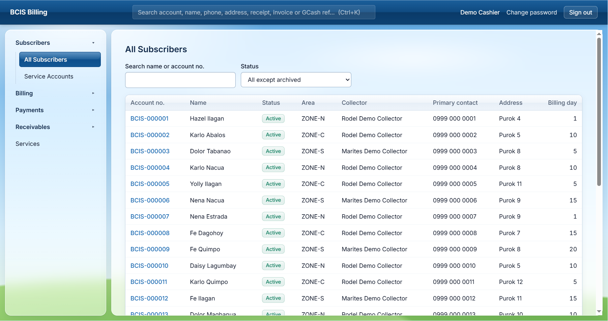

---

## 2. Getting started

### 2.1 Signing in

1. Open **BCIS Billing** from the Start menu.
2. Type your **Username** and **Password** and press **Sign in**.
3. The first time on a new PC, check the server address shown under the sign-in box. If it is wrong,
   press **Change**, type the address of the server PC (for example `192.168.1.10`), and press
   **Test and save**. Your administrator will tell you the address.

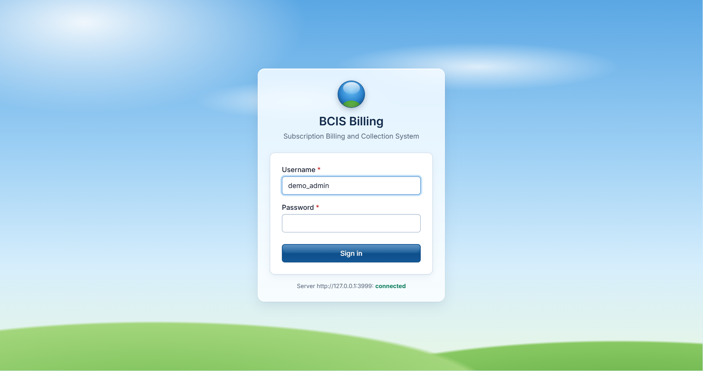

**New account or reset password:** you sign in with the temporary password the owner gave you, and
the app asks you to choose your own password (at least 10 characters) before you can continue.
Nobody else will know it.

**Wrong password five times:** the account locks for 15 minutes. Wait, or ask the owner to unlock
it.

**Change your password** at any time with **Change password** in the top bar. **Sign out** when you
leave the PC; the app also signs you out after 30 minutes without activity.

### 2.2 The screen

- **Menu** on the left, grouped by area. Click a group to open it.
- **Search** at the top (or press **Ctrl+K**): type an account number, name, phone, address,
  receipt number, invoice number or GCash reference and choose a result to open the subscriber.
- Money is always shown in pesos with two decimals, right-aligned. Statuses are shown as a word in a
  coloured badge (for example **Overdue**, **Paid**).

### 2.3 Dashboard

The dashboard shows this month's billing and collections, the collection rate, the total still
owed, overdue accounts, suspension candidates, billing against collection for the last six months,
collections by payment method, the aging of what is owed, and how each collector is doing. Each
chart has a **Table** button to see the same figures as a table. Press **Refresh** to update.

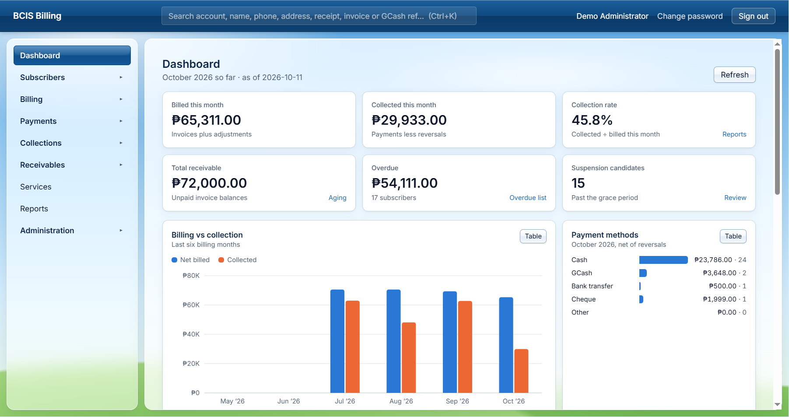

---

## 3. Subscribers

### 3.1 Finding a subscriber

Use **Subscribers > All Subscribers**: search by name or account number and filter by status, or
use the search box at the top. Click the account number to open the profile.

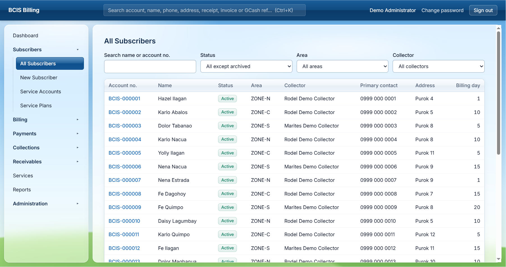

### 3.2 Registering a new subscriber

1. Open **Subscribers > New Subscriber**.
2. Fill in **Full name** and **Billing day** (the day of the month the bill is due).
3. Under **Service address**, fill in the street or purok, barangay and city.
4. Add at least one contact (mobile number, landline or email).
5. Optionally choose the collection **Area** and **Collector**.
6. Press **Create subscriber**. The new account number (BCIS-…) is assigned and the profile opens.

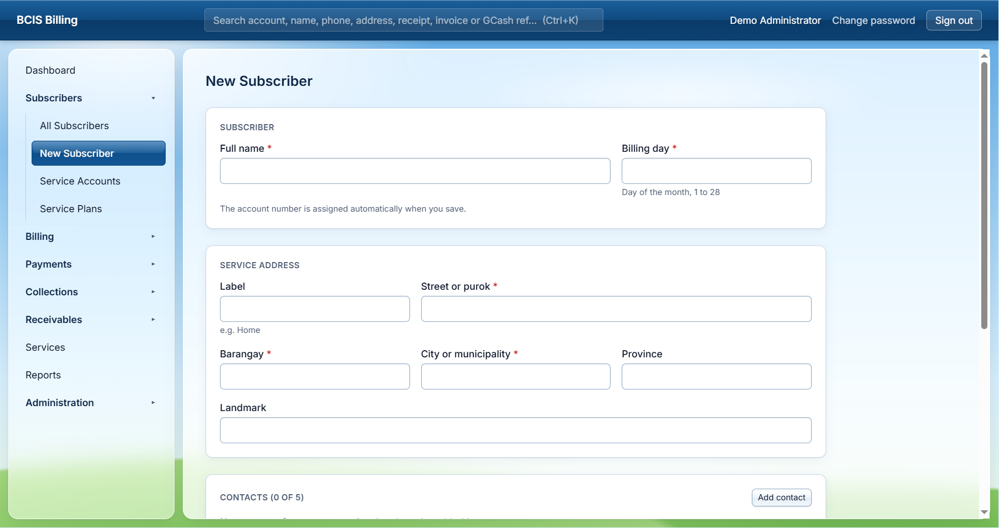

### 3.3 The subscriber profile

The profile has nine tabs:

| Tab | What it shows |
|---|---|
| Overview | Details and current balance, collector assignment, addresses, contacts |
| Services | Each service account (internet, cable, combo): plan, rate, status; add or change services |
| Billing | The subscriber's invoices |
| Payments | Payments and GCash submissions |
| Ledger | Every charge and payment with a running balance, and the Statement of Account |
| Collection | Collection batches the subscriber was on, and what was collected |
| Service history | Every change to the account and its services, with who and why |
| Documents | Statement of Account, receipts to reprint, GCash proof images |
| Audit | The full audit trail of this subscriber |

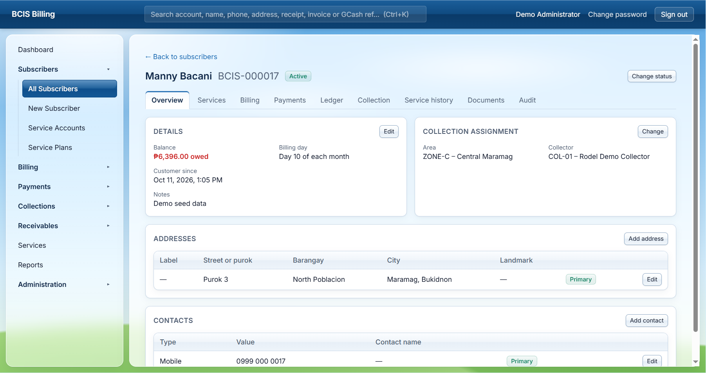

- **Edit** details, addresses and contacts with the buttons on each section; each change asks for an
  optional reason and is recorded.
- **Change status** (top right) to make a subscriber inactive, terminated or archived. A reason is
  required. Subscribers are never deleted.

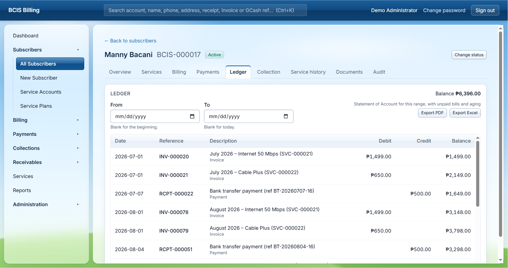

### 3.4 Adding and activating a service

1. On the **Services** tab, press **Add service**, choose the plan and the installation address.
   The service starts as **Pending** (waiting for installation).
2. When the line is installed, open the service and change its status to **Active** with the
   activation date. Billing starts from that date; the installation fee goes on the first bill.
3. Plan and rate changes are made on the service page and are kept in the service history.

Technicians see services waiting for installation, suspended services and reconnections under
**Services**.

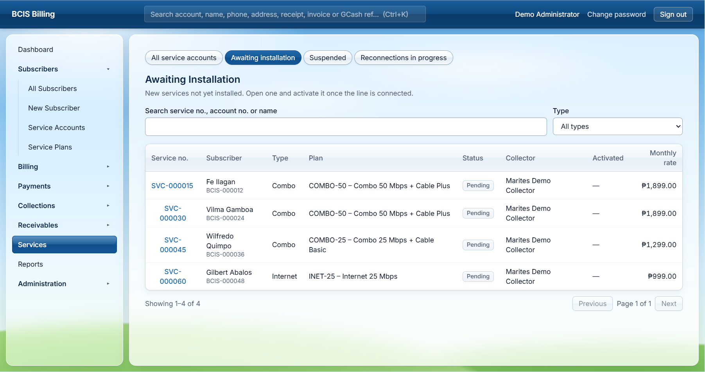

---

## 4. Monthly billing

Billing is done once a month in two steps, so the bills can be checked before they are numbered.

1. Open **Billing > Generate Billing** and choose the **Billing month**.
2. Press **Generate drafts**. Draft invoices are created for every active service that has no bill
   for that month yet. Drafts have no number and do not affect balances.
3. Review the drafts (open them to see the lines). If a rate was wrong, fix it on the service,
   **Discard drafts** and generate again.
4. Press **Finalize** and confirm. The invoices get their numbers (INV-…), are posted to the
   subscribers' ledgers, and any advance payment (credit) is applied to them.

Running Generate again for the same month only adds bills for services that became active since; a
service never gets two bills for the same month.

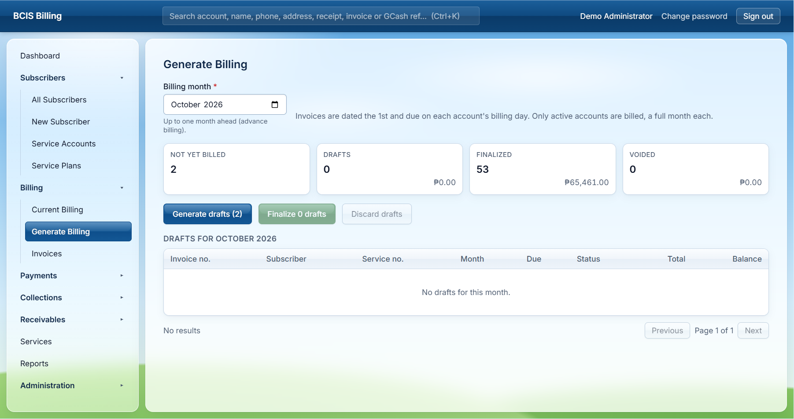

**Invoices** (Billing > Invoices, or Current Billing for this month) lists all bills with their
status: Unpaid, Partially paid, Paid, Overdue (unpaid after the due date) or Void.

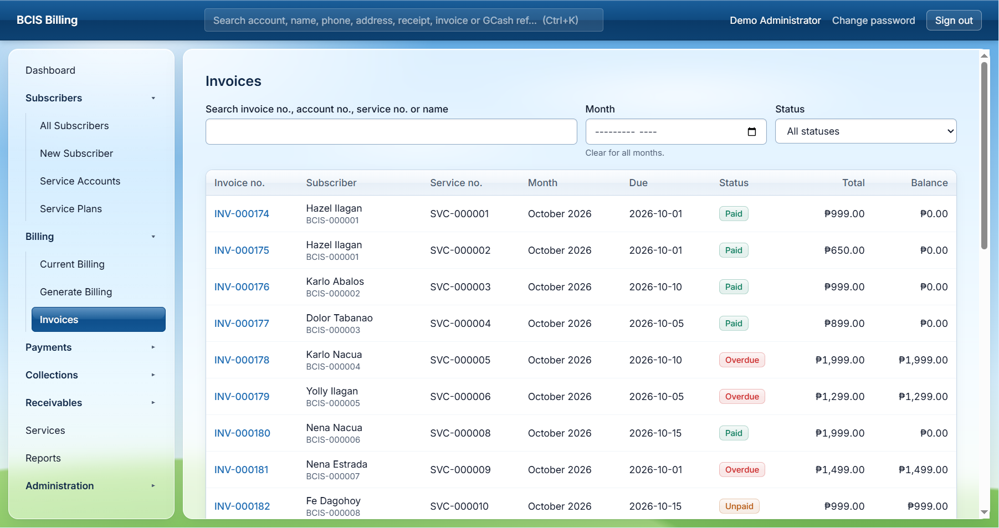

**Voiding a bill** (open the invoice, **Void invoice**, give a reason): only possible while no
payment is applied to it; reverse the payment first if needed. The number is kept and the month can
be billed again.

**Adjustments** (open the invoice, **Adjust**): a **credit** lowers what is owed (discount, outage
rebate, billing error, goodwill); a **debit** adds a charge (penalty, reconnection fee, billing
error). Choose the category, the amount and a reason. A credit cannot be more than what is still
owed.

**Statement of Account**: on the subscriber's **Ledger** or **Documents** tab, choose a date range
and press **Export PDF** or **Export Excel**.

---

## 5. Payments at the counter

### 5.1 Receiving a payment

1. Open **Payments > Receive Payment** and find the subscriber (account number, name, phone or
   address).
2. The screen shows the balance owed, any credit, and the open bills, oldest first.
3. Type the **Amount received**. The **allocation preview** shows how it will be applied: the
   oldest bill is paid first, then the next. Anything more than what is owed is kept as credit for
   future bills.
4. Choose the **Method** (cash, bank transfer, cheque, other). Bank transfers and cheques need the
   reference or cheque number.
5. The **Payment date** is today unless the customer paid earlier (never a future date).
6. Press **Post payment**. The receipt (RCPT-…) opens, ready to print.

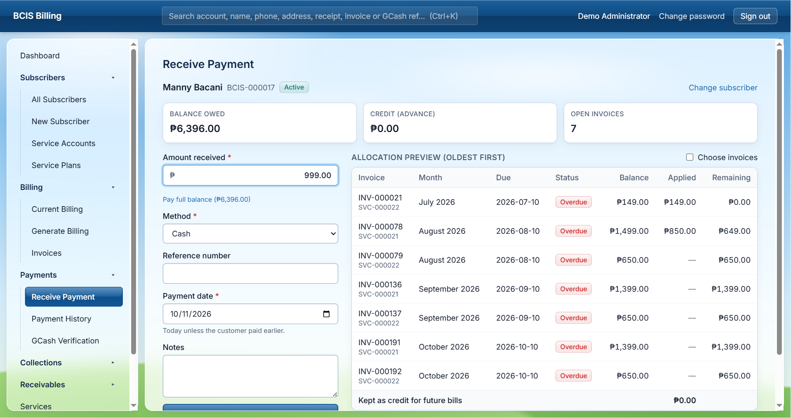

Administrators can tick **Choose invoices** to apply the payment to specific bills instead of
oldest first.

### 5.2 Receipts and payment history

**Payments > Payment History** lists every payment. Click a receipt number to open it and press
**Print receipt** (reprints are marked as such).

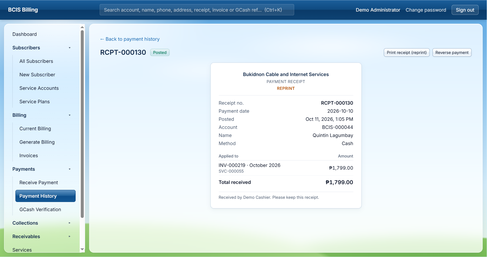

### 5.3 Reversing a payment

If a payment was posted by mistake (wrong subscriber, wrong amount), open it and press **Reverse
payment**, then give the reason. The payment stays on file marked **Reversed**, the bills it paid
are open again, and the reversal is recorded with your name and the reason. Then post the correct
payment. Payments are never deleted.

---

## 6. GCash payments

Customers who pay by GCash send the reference number and a screenshot (usually by message).

1. Open **Payments > GCash Verification** and press **Record GCash payment**.
2. Choose the subscriber, type the **GCash reference no.**, **Sender name**, **Sender mobile no.**,
   **Amount** and **Transaction date**, and save.
3. **Attach image**: add the screenshot (PNG, JPEG or WebP, up to 5 MB).
4. A reviewer checks the screenshot against the details and presses **Verify…**. This posts the
   payment (method GCash, dated on the transaction date) and issues a receipt. If something does not
   match, press **Reject…** and give the reason.

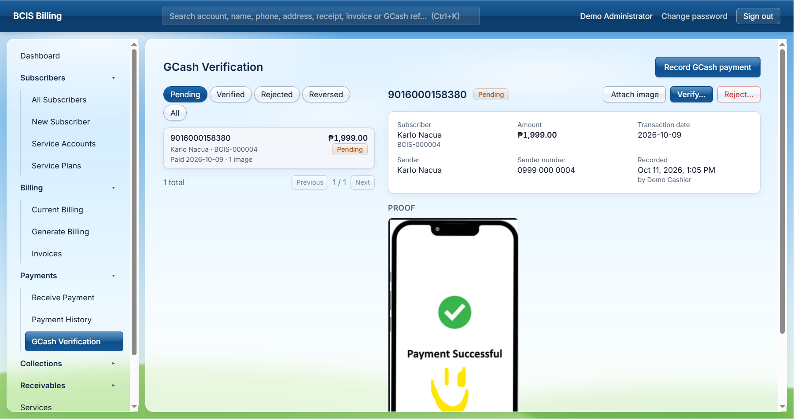

**A reference can only be used once.** If the same GCash reference is entered again, the system
refuses it and names the receipt that already used it. This protects against the same screenshot
being sent twice.

---

## 7. Collections

### 7.1 Collectors and areas

**Collections > Areas & Routes** and **Collectors** hold the collection areas and the field
collectors. Assign a subscriber's area and collector on their profile (Overview, **Collection
assignment**). The Collectors screen also shows each collector's performance.

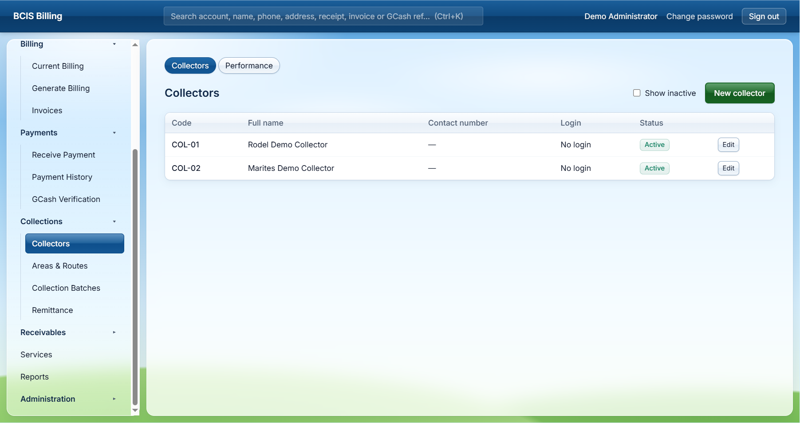

### 7.2 A collection batch, step by step

1. **Collections > Collection Batches > New batch**: choose the **Collector**, optionally one
   **Area**, and the **Collection date**. The batch lists everyone on the collector's route who owes
   something, with what they owe.
2. **Print route sheet** for the collector to take, then **Dispatch…** when they leave.
3. When the collector returns, **Record collection** for each payment on their tally (subscriber,
   cash or cheque, amount, the collector's paper receipt number). Each one posts a payment with an
   official receipt.
4. **Submit…** when all collections are entered.
5. **Record remittance**: the cash the collector actually hands over, counted.
6. **Reconcile…**: the system shows expected cash against remitted cash. If they differ, the
   shortage or overage is shown and you must give a reason. Confirm the difference shown.
7. **Close batch…**: confirm the same difference again to close.

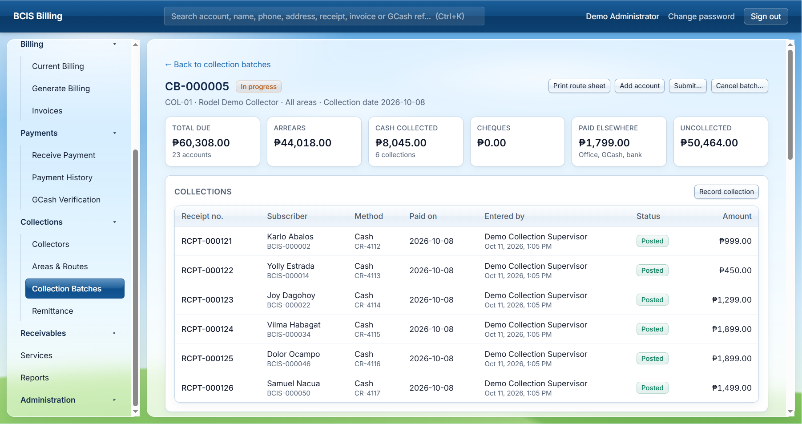

A short batch can never be closed as balanced: the shortage stays on the batch, in the collector
report and on the dashboard.

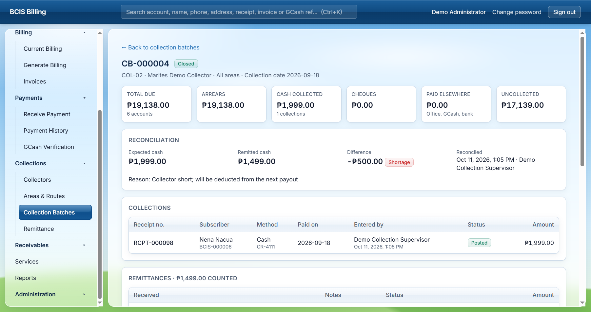

---

## 8. Receivables, suspensions and reconnections

- **Receivables > Outstanding** lists every open balance; **Overdue** only accounts with unpaid
  bills past their due date. Filter by collector, area, service type or age, and export.
- **Receivables > Aging** groups what is owed by how late it is: current, 1-30, 31-60, 61-90 and
  over 90 days. Advance payments (credit) are shown separately.

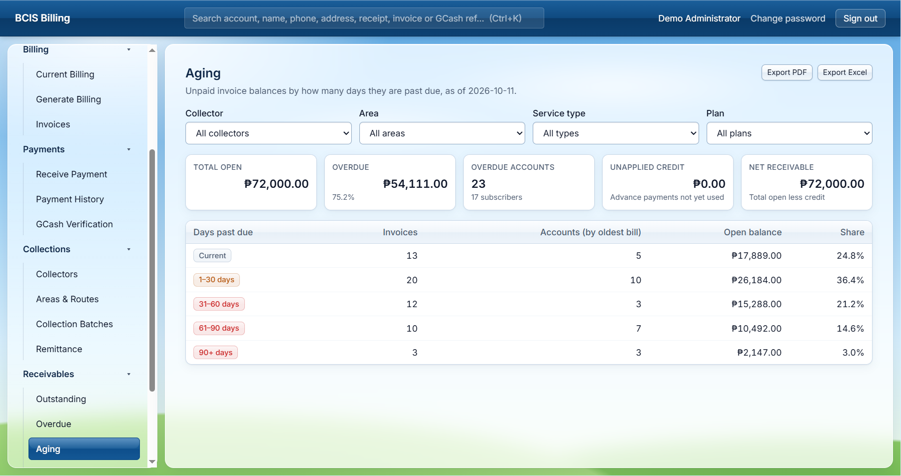

- **Receivables > Suspension Candidates** lists active services with too many unpaid bills past the
  grace period (both set in Settings). The list is advice: to suspend, open the service, press
  **Suspend service**, and give the reason, the date and who approved it.
- **Reconnection**: when the customer settles, open the suspended service and press **Request
  reconnection** (the reconnection fee goes on the next bill, or tick the waiver and say why).
  **Assign technician**, and the technician presses **Mark completed** when the line is back on.

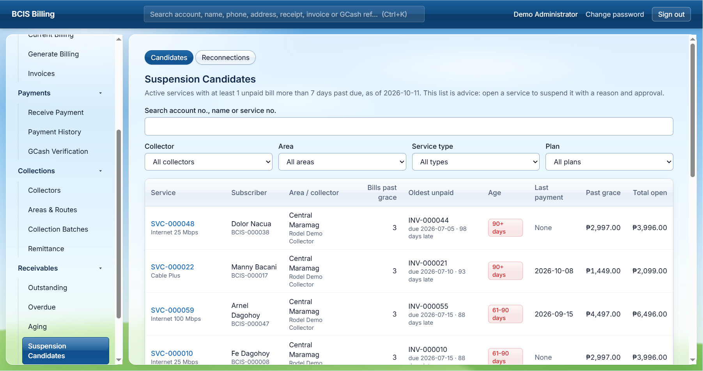

---

## 9. Reports

Open **Reports** and choose a report: Collections, Billing vs collection, Revenue, Subscriber master
list, Adjustments & reversals. Choose the dates or months, then **Export PDF** (to print or send) or
**Export Excel** (to analyse). The aging report is under Receivables, the collector report under
Collectors, the user activity report under Audit Log, and the Statement of Account on each
subscriber. Every export is recorded in the audit log.

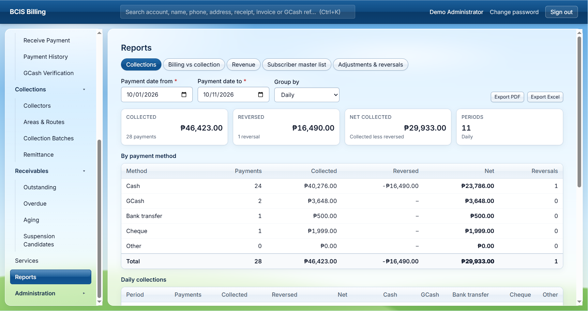

---

## 10. Administration

### 10.1 Users (owner)

**Administration > Users**: **New user** creates an account with a username, full name, roles and a
temporary password (the screen can generate one; give it to the person privately). From each user's
row you can change their name or roles, deactivate them, unlock a locked account, or reset the
password. You cannot deactivate yourself, and the last owner cannot be removed.

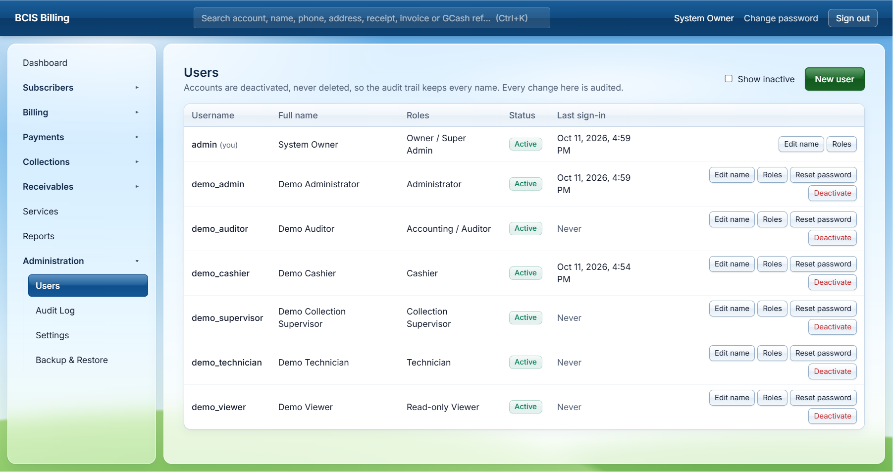

### 10.2 Settings (owner)

**Administration > Settings**: the grace period (days after the due date before a bill counts
toward suspension) and the suspension threshold (how many such bills make a service a candidate).

### 10.3 Audit log

**Administration > Audit Log** shows every change: when, who, what, the reason, and the old and new
values. Filter by date, user, area of the system or record. Nothing in it can be changed.

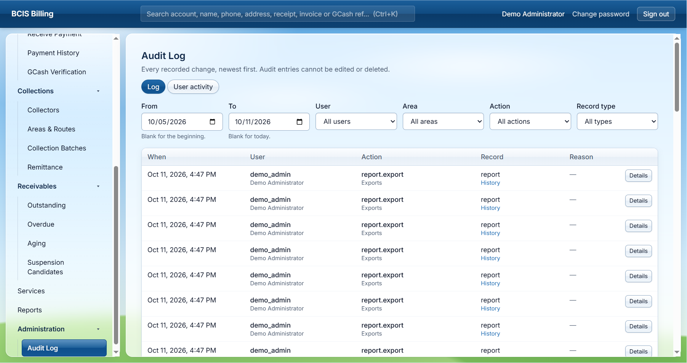

### 10.4 Backups and restore (owner)

A backup runs automatically every evening on the server. **Administration > Backup & Restore** shows
them all; a warning appears if the last good backup is more than a day old.

- **Back up now** makes a backup immediately (add a note, for example "before month-end").
- **Verify again** re-checks a backup's files.
- **Test restore** restores a backup into a separate practice database and checks it, without
  touching live data. Do this regularly.
- **Run integrity check** checks the live data: every paid amount matches its payments, every
  ledger balances, numbers cannot repeat, proof images are intact.

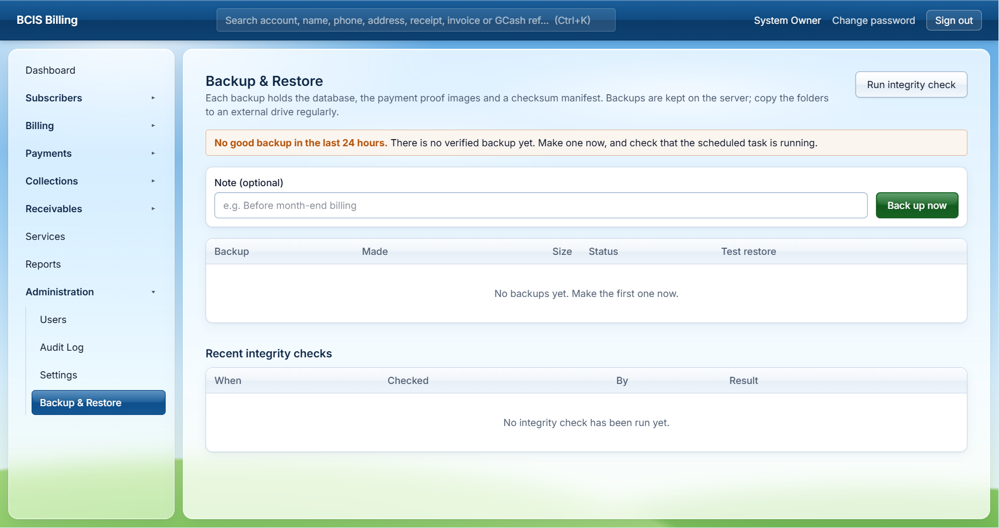

**Restoring** replaces all data on every PC with the backup, so it is for real emergencies only:

1. Tell everyone to stop working; they will be signed out.
2. Press **Restore…** on the backup, type its number (BK-…) to confirm, and give the reason.
3. The system first makes a safety backup of the current data, then restores, then runs the
   integrity check and shows the result.
4. Everyone signs in again. Anything entered after that backup was taken must be entered again.

---

## 11. Troubleshooting

| Problem | What to do |
|---|---|
| "Cannot reach the BCIS server" | Check the network cable or Wi-Fi. Check the server address under the sign-in box (**Change**, then **Test and save**). Ask the administrator whether the server PC is on. |
| "Please sign in again" | You were inactive for 30 minutes or signed in for 12 hours. Sign in again; nothing saved is lost. |
| The account is locked at sign-in | Five wrong passwords. Wait 15 minutes or ask the owner to unlock it. |
| "You do not have permission" | Your role does not include that action. Ask the owner if you need it. |
| "Something went wrong on the server" with a reference | Note the reference and tell the administrator; it points to the exact entry in the server log. Check whether the action was saved (for example, look in Payment History) before trying again. |
| "The database is not available right now" | The server cannot reach PostgreSQL. The administrator should check the database service on the server PC. |
| "The system is being restored from a backup" | A restore is running. Wait for it to finish and sign in again. |
| The GCash reference "is already used" | That transfer was already posted (the message names the receipt). Do not post it again; check with the customer. |
| Cannot void an invoice | It has payments applied. Reverse the payment first, then void. |
| A credit adjustment is refused | It is more than what is still owed on that bill. |
| "The figures changed" when reconciling | Something was added to the batch since you opened it. Review the batch and confirm the new difference. |
| Backup warning on the Backup screen | The last good backup is more than a day old. Press **Back up now** and tell the administrator to check the scheduled backup on the server. |
| A receipt does not print | Check the printer, then open the payment in Payment History and press **Print receipt** again. |
